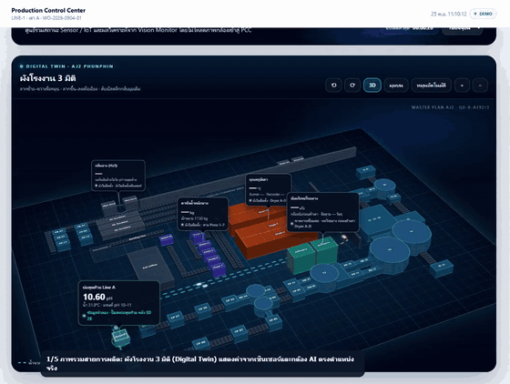
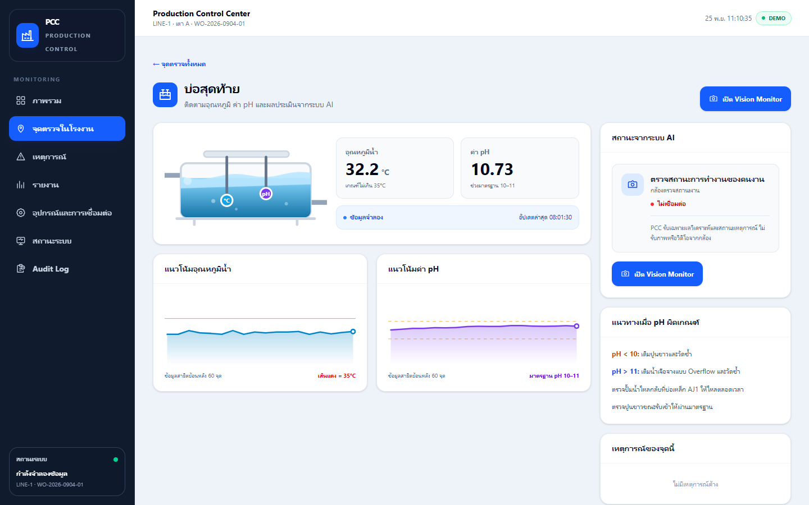

# Factory PCC · Production Control Center and Vision AI

A monitoring system for a rubber processing line. The **Production Control Center (PCC)** brings sensor, IoT and computer-vision results together on one dashboard, with a 3D plan of the plant that shows each reading where it's measured. **Rack AI** is the vision service behind it: it counts racks entering the dryer from a CCTV camera and checks activity at the final treatment pond. Both were built for and handed over to the factory in November 2026.

[](docs/media/pcc-demo.mp4)

*The PCC dashboard in its built-in simulation mode. Select it to open the 60-second walkthrough (MP4, 2.2 MB). Every value comes from the simulator, not from the plant.*

## Production Control Center (`PCC/`)

| Area | Details |
| --- | --- |
| Digital twin | A 3D plan of the plant built with CSS 3D transforms and SVG, without a WebGL library. You can rotate it, switch to a top view and set it to rotate on its own. Sensor and vision readings sit on their stations |
| Stations | Final pond temperature and pH with trends and corrective steps, rack count at the dryer infeed, H2S odour sensor, rubber scale and dryer temperature. Each station shows whether its data is live, simulated, delayed or not installed |
| Incidents | Alerts from all sources in one place, with owner and corrective-action tracking |
| Reports and audit | Production reports from sensor and vision data, and an audit log of user actions |
| Devices and health | Readiness per sensor, camera and gateway, plus overall system status |
| Simulation mode | Without hardware connected, a scenario simulator drives every station, so the whole UI can be demonstrated and tested |



**Stack:** Next.js 16 (App Router), React 19, TypeScript, Tailwind CSS 4, and Supabase for authentication and storage. Sensors post to a versioned telemetry API (`/api/v1/telemetry`) with a bearer token, and a rule engine turns readings into alerts. Contracts for telemetry, rack events and incident actions are validated and tested (`npm test`, 11 test files).

## Rack AI vision service (`rack_ai/`)

- **Rack counting.** YOLO detection with ByteTrack tracking and a line-crossing counter count racks entering the dryer from CCTV camera 09. Counts are grouped by shift and synced to PCC as events.
- **Final pond.** Detects workers inside a defined pond work zone, tracks a lever operation with a small state machine, and checks PPE.
- **DVR integration.** Reads Hikvision DVR streams and recorded playback over RTSP and ISAPI, including a probe tool for firmware that doesn't match its documentation.
- **Dataset lab.** Tools to import, de-duplicate and select frames, export to Colab or Roboflow, train and evaluate models.
- **Service.** FastAPI with a separate inference worker, a Rack Monitor web UI, Docker and Windows deployment scripts, and 30 pytest files.

Trained model weights and camera footage are not included: they come from the factory's own cameras.

## Deployment (`deploy/`)

Windows scripts install the services on the factory server, run preflight checks, sync rack events into PCC, back up runtime data and bridge the pond pH board (`deploy/windows/PondPhBridge.py`) into the telemetry API. `contracts/` holds the JSON contracts shared by PCC and Rack AI.

## Run the dashboard locally

Requires Node.js 22 or later. Without Supabase settings, PCC runs in simulation mode.

```powershell
cd PCC
npm ci
$env:PCC_AUTH_REQUIRED = "false"
$env:H2S_GATEWAY_URL = "off"
npm run dev
```

Open <http://localhost:3000>. To connect real services, copy `PCC/env.example` to `PCC/.env.local` and fill in the values.

## About the data

The screenshots and video come from PCC's simulation mode. IP addresses in the code and docs are examples. No production data, credentials, camera footage or trained model weights are included.
